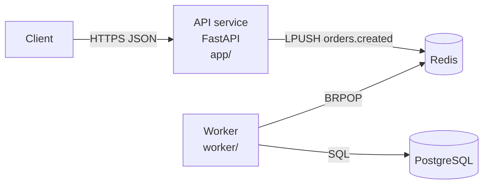

# Technical documentation templates from source code

Contents: [README](#readme) · [API reference](#api-reference) · [Architecture](#architecture) · [ADR](#adr) · [Runbook](#runbook) · [Module doc](#module)

---

<a id="readme"></a>
## README

Measurable goal: a developer who has never seen the repo can get the service running on their machine in ≤ 15 minutes using only the README.

```markdown
# <service-name>
<1–2 sentences: what the service does, for whom. No marketing.>

## Contents (when the README is > ~150 lines)

## Key features
- <concrete behaviour, verb + object>

## System requirements
| Component | Version | Source |
|---|---|---|
| Python | 3.11 | Dockerfile `FROM python:3.11-slim` |
| Redis | [TO CONFIRM] | used at worker/main.py:8 |

## Install & run locally
1. Clone + install dependencies (exact command from the manifest).
2. Create the config file (`cp .env.example .env`) — if the repo has one.
3. Start dependencies (docker compose up -d redis).
4. Run the service (exact command from the entrypoint/Makefile).
5. Check: `curl http://localhost:<port>/health` → expected result.

## Configuration
| Variable | Required | Default | Description | Read at |
|---|---|---|---|---|

## API (summary) — or link to the API reference
| Method | Path | Description | Auth |

## Running tests
## Directory structure
<condensed tree, one comment line per main directory>

## Deploy (if the repo has deploy configuration)
## Known limitations / technical debt
## Contributing / contact (only when the repo has this information)
```

---

<a id="api-reference"></a>
## API reference

Group by resource. For each endpoint:

```markdown
### `POST /api/v1/orders` — Create an order
Handler: `app/routers/orders.py:24` · Auth: Bearer token (header `Authorization`)

**Request body** (`OrderCreate`)
| Field | Type | Required | Constraints | Description |
|---|---|---|---|---|
| items | array<OrderItem> | Yes | 1–50 items (`ORDER_MAX_ITEMS`) | |

**Response**
| Status | When | Body |
|---|---|---|
| 201 | Created successfully | `OrderOut` |
| 422 | Body does not match schema | framework validation error |
| 409 | <exact condition in code> | `{"detail": "<exact string in code>"}` |

**Example**
```bash
curl -X POST http://localhost:8000/api/v1/orders \
  -H "Authorization: Bearer <token>" -H "Content-Type: application/json" \
  -d '{"items":[{"sku":"A1","qty":2}]}'
```
```

Rule: take status codes and error messages exactly from the code (`raise HTTPException(409, "...")`). Do not list status codes the code does not return. Document idempotency, pagination and rate limits only when the code has them.

---

<a id="architecture"></a>
## Architecture overview (condensed arc42 + C4 level 1–2)

```markdown
# <System> architecture
## 1. Purpose & scope of this document
## 2. Context (C4 L1)
<System, users, external systems. Mermaid flowchart.>
## 3. Containers / components (C4 L2)
| Component | Technology | Responsibility | Source code | Communicates with |
## 4. Main flows (runtime view)
<The 1–3 most important flows, as sequence diagrams + a step-by-step description with file:line.>
## 5. Data
<Which stores, main schema, who reads/writes.>
## 6. Configuration & deployment
## 7. Observed design decisions
<Decision + consequence/trade-off. Do not guess the rationale if the code/commits do not state it — write "rationale not recorded".>
## 8. Risks & technical debt
| Issue | Evidence (file:line) | Impact | Proposal |
## 9. Open questions
```

Sample Mermaid:


---

<a id="adr"></a>
## ADR (Architecture Decision Record — Michael Nygard format)

```markdown
# ADR-<NNN>: <Decision, stated as a clause>
- Status: Proposed | Accepted | Superseded by ADR-xxx
- Date: YYYY-MM-DD · Decided by: <...>

## Context
<Forces at play: requirements, constraints, figures.>
## Options considered
| Option | Pros | Cons | Cost/risk |
## Decision
<What was chosen, scope of application.>
## Consequences
<Good, bad, follow-up work, when to revisit.>
```

---

<a id="runbook"></a>
## Runbook

```markdown
# Runbook: <service>
## Quick facts
| Item | Value |
|---|---|
| Owner / on-call | [TO CONFIRM] |
| Health check | `GET /health` → 200 `{"status":"ok"}` (app/main.py:15) |
| Logs | <where to view logs> |
| Dashboard | [TO CONFIRM] |

## Start / stop / restart
## Common incidents
### <Observable symptom>
- Likely cause: <...> (evidence: file:line)
- Check: <exact command>
- Fix: <concrete steps; reversible?>
- Escalate when: <condition>
## Risky operations (require confirmation by 2 people)
```

---

<a id="module"></a>
## Module / component doc

```markdown
# Module `<path>`
## Responsibility (1 paragraph)
## Public interface
| Function/Class | Signature | Description | Errors raised |
## Dependencies (which modules it calls, who calls this module)
## Main processing flow
## Invariants & assumptions
## How to test
## Known limitations
```
