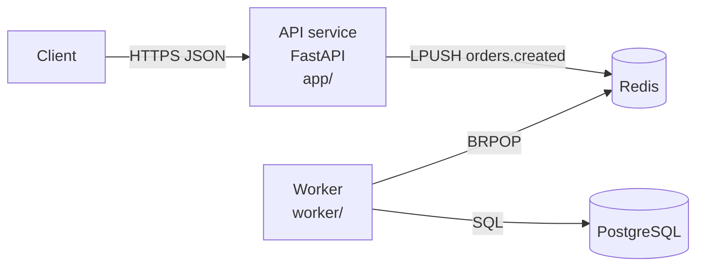

# Templates tài liệu kỹ thuật từ source code

Mục lục: [README](#readme) · [API reference](#api-reference) · [Architecture](#architecture) · [ADR](#adr) · [Runbook](#runbook) · [Module doc](#module)

---

<a id="readme"></a>
## README

Mục tiêu đo được: một dev chưa từng thấy repo chạy được service trên máy trong ≤ 15 phút chỉ bằng README.

```markdown
# <tên-service>
<1–2 câu: service làm gì, cho ai. Không marketing.>

## Mục lục (khi README > ~150 dòng)

## Tính năng chính
- <hành vi cụ thể, động từ + đối tượng>

## Yêu cầu hệ thống
| Thành phần | Phiên bản | Nguồn |
|---|---|---|
| Python | 3.11 | Dockerfile `FROM python:3.11-slim` |
| Redis | [CẦN XÁC NHẬN] | được dùng tại worker/main.py:8 |

## Cài đặt & chạy local
1. Clone + cài dependency (lệnh chính xác theo manifest).
2. Tạo file cấu hình (`cp .env.example .env`) — nếu repo có.
3. Khởi động dependency (docker compose up -d redis).
4. Chạy service (lệnh chính xác theo entrypoint/Makefile).
5. Kiểm tra: `curl http://localhost:<port>/health` → kết quả mong đợi.

## Cấu hình
| Biến | Bắt buộc | Mặc định | Mô tả | Đọc tại |
|---|---|---|---|---|

## API (tóm tắt) — hoặc link tới API reference
| Method | Path | Mô tả | Auth |

## Chạy test
## Cấu trúc thư mục
<cây rút gọn, mỗi thư mục chính một dòng chú thích>

## Deploy (nếu repo có cấu hình deploy)
## Hạn chế đã biết / nợ kỹ thuật
## Đóng góp / liên hệ (chỉ khi có thông tin trong repo)
```

---

<a id="api-reference"></a>
## API reference

Nhóm theo resource. Mỗi endpoint:

```markdown
### `POST /api/v1/orders` — Tạo đơn hàng
Handler: `app/routers/orders.py:24` · Auth: Bearer token (header `Authorization`)

**Request body** (`OrderCreate`)
| Field | Kiểu | Bắt buộc | Ràng buộc | Mô tả |
|---|---|---|---|---|
| items | array<OrderItem> | Có | 1–50 phần tử (`ORDER_MAX_ITEMS`) | |

**Response**
| Status | Khi nào | Body |
|---|---|---|
| 201 | Tạo thành công | `OrderOut` |
| 422 | Body sai schema | lỗi validation của framework |
| 409 | <điều kiện cụ thể trong code> | `{"detail": "<chuỗi chính xác trong code>"}` |

**Ví dụ**
```bash
curl -X POST http://localhost:8000/api/v1/orders \
  -H "Authorization: Bearer <token>" -H "Content-Type: application/json" \
  -d '{"items":[{"sku":"A1","qty":2}]}'
```
```

Quy tắc: status code và message lỗi lấy đúng từ code (`raise HTTPException(409, "...")`). Không liệt kê status code mà code không trả. Ghi idempotency, pagination, rate limit chỉ khi code có.

---

<a id="architecture"></a>
## Architecture overview (arc42 rút gọn + C4 level 1–2)

```markdown
# Kiến trúc <hệ thống>
## 1. Mục đích & phạm vi tài liệu
## 2. Context (C4 L1)
<Hệ thống, người dùng, hệ thống ngoài. Mermaid flowchart.>
## 3. Containers / thành phần (C4 L2)
| Thành phần | Công nghệ | Trách nhiệm | Mã nguồn | Giao tiếp với |
## 4. Luồng chính (runtime view)
<1–3 luồng quan trọng nhất, dạng sequence diagram + mô tả từng bước có file:line.>
## 5. Dữ liệu
<Store nào, schema chính, ai đọc/ghi.>
## 6. Cấu hình & triển khai
## 7. Các quyết định thiết kế quan sát được
<Quyết định + hệ quả/trade-off. Không phỏng đoán lý do nếu code/commit không nói — ghi "lý do chưa được ghi nhận".>
## 8. Rủi ro & nợ kỹ thuật
| Vấn đề | Bằng chứng (file:line) | Ảnh hưởng | Đề xuất |
## 9. Câu hỏi mở
```

Mermaid mẫu:


---

<a id="adr"></a>
## ADR (Architecture Decision Record — định dạng Michael Nygard)

```markdown
# ADR-<NNN>: <Quyết định, dạng mệnh đề>
- Trạng thái: Proposed | Accepted | Superseded by ADR-xxx
- Ngày: YYYY-MM-DD · Người quyết định: <...>

## Bối cảnh
<Lực tác động: yêu cầu, ràng buộc, số liệu.>
## Các phương án đã cân nhắc
| Phương án | Ưu | Nhược | Chi phí/rủi ro |
## Quyết định
<Chọn gì, phạm vi áp dụng.>
## Hệ quả
<Tốt, xấu, việc cần làm tiếp, khi nào cần xem lại.>
```

---

<a id="runbook"></a>
## Runbook

```markdown
# Runbook: <service>
## Thông tin nhanh
| Mục | Giá trị |
|---|---|
| Owner / on-call | [CẦN XÁC NHẬN] |
| Health check | `GET /health` → 200 `{"status":"ok"}` (app/main.py:15) |
| Log | <nơi xem log> |
| Dashboard | [CẦN XÁC NHẬN] |

## Khởi động / dừng / restart
## Sự cố thường gặp
### <Triệu chứng quan sát được>
- Nguyên nhân khả dĩ: <...> (căn cứ: file:line)
- Kiểm tra: <lệnh chính xác>
- Xử lý: <bước cụ thể, có thể đảo ngược?>
- Escalate khi: <điều kiện>
## Thao tác rủi ro (cần 2 người xác nhận)
```

---

<a id="module"></a>
## Module / component doc

```markdown
# Module `<path>`
## Trách nhiệm (1 đoạn)
## Public interface
| Hàm/Class | Chữ ký | Mô tả | Lỗi ném ra |
## Phụ thuộc (gọi tới module nào, ai gọi module này)
## Luồng xử lý chính
## Bất biến & giả định (invariants)
## Cách test
## Hạn chế đã biết
```
