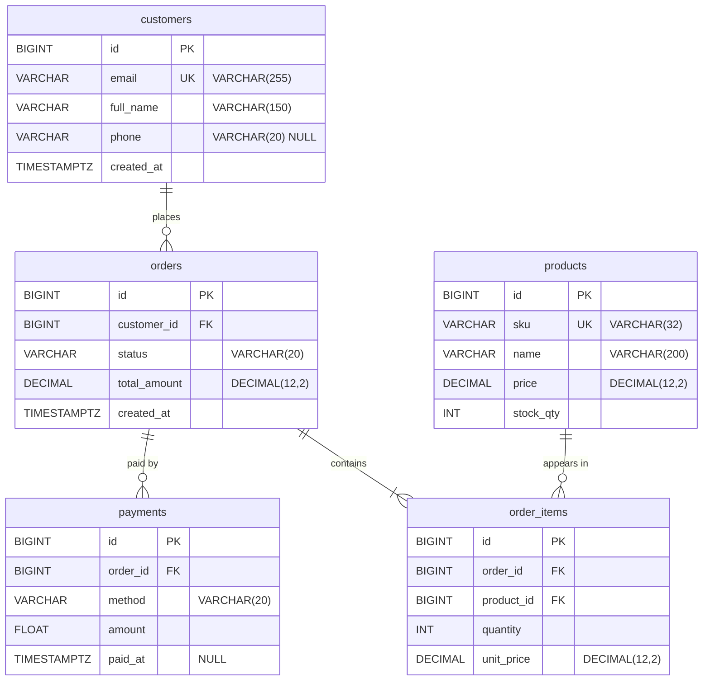

# Data Dictionary: Module bán hàng

| Phiên bản | Ngày | Nguồn | Owner | Trạng thái |
|---|---|---|---|---|
| 0.1 | 2026-11-03 | `erd_sales.png` ("ERD — Module bán hàng") | [CẦN XÁC NHẬN: owner tài liệu] | Draft |

> **Tóm tắt:** Tài liệu mô tả 5 bảng (`customers`, `orders`, `order_items`, `products`, `payments`), 25 cột và 4 quan hệ của module bán hàng, trích từ ảnh ERD. Ba vấn đề cần chốt trước khi dùng làm chuẩn dữ liệu: (1) `payments.amount` dùng kiểu FLOAT cho tiền, khác `DECIMAL(12,2)` ở các cột tiền còn lại — ISS-01; (2) ERD không ghi danh sách giá trị hợp lệ của `orders.status` và `payments.method` — ISS-04; (3) quy ước NULL chỉ ghi ở 2 cột, các cột còn lại đang được giả định NOT NULL — AS-001. Danh sách câu hỏi cần trả lời ở mục 7.

## 1. Tổng quan

Phạm vi: toàn bộ bảng, cột, khóa và quan hệ thể hiện trên ảnh `erd_sales.png`. Tài liệu không mô tả bảng hoặc cột không có trên ảnh.

| Bảng | Mô tả nghiệp vụ | Số cột | Khóa chính | Khóa duy nhất (UQ) |
|---|---|---|---|---|
| `customers` | Khách hàng đặt đơn | 5 | `id` | `email` |
| `orders` | Đơn hàng của khách | 5 | `id` | — |
| `order_items` | Dòng sản phẩm trong đơn hàng | 5 | `id` | — |
| `products` | Danh mục sản phẩm bán | 5 | `id` | `sku` |
| `payments` | Giao dịch thanh toán của đơn hàng | 5 | `id` | — |

Quy ước đọc bảng ở mục 2:
- **Null = "Có"**: ảnh ghi chữ `NULL` sau kiểu dữ liệu (chỉ có ở `customers.phone` và `payments.paid_at`).
- **Null = "Không"**: ảnh không ghi `NULL`. Đây là giả định AS-001 (mục 6), chưa được ảnh xác nhận trực tiếp.
- **Khóa**: PK = khóa chính; FK = khóa ngoại; UQ = giá trị duy nhất — đúng như nhãn trên ảnh.
- Kiểu `TIMESTAMPTZ` lưu thời điểm kèm múi giờ.

## 2. Đặc tả từng bảng

### 2.1 Bảng `customers` — Khách hàng

| Cột | Kiểu | Null | Khóa | Tham chiếu | Mô tả nghiệp vụ |
|---|---|---|---|---|---|
| `id` | BIGINT | Không | PK | — | Định danh khách hàng |
| `email` | VARCHAR(255) | Không | UQ | — | Email khách hàng; mỗi email chỉ thuộc một khách hàng (DR-002) |
| `full_name` | VARCHAR(150) | Không | — | — | Họ và tên của khách hàng |
| `phone` | VARCHAR(20) | Có | — | — | Số điện thoại; không bắt buộc. Định dạng [CẦN XÁC NHẬN: OQ-008] |
| `created_at` | TIMESTAMPTZ | Không | — | — | Thời điểm tạo bản ghi khách hàng |

### 2.2 Bảng `orders` — Đơn hàng

| Cột | Kiểu | Null | Khóa | Tham chiếu | Mô tả nghiệp vụ |
|---|---|---|---|---|---|
| `id` | BIGINT | Không | PK | — | Định danh đơn hàng |
| `customer_id` | BIGINT | Không | FK | `customers.id` | Khách hàng đặt đơn (quan hệ "places") |
| `status` | VARCHAR(20) | Không | — | — | Trạng thái đơn hàng. Danh sách giá trị hợp lệ [CẦN XÁC NHẬN: OQ-001] |
| `total_amount` | DECIMAL(12,2) | Không | — | — | Tổng giá trị đơn hàng. Đơn vị tiền tệ [CẦN XÁC NHẬN: OQ-003]; cách tính [CẦN XÁC NHẬN: OQ-004] |
| `created_at` | TIMESTAMPTZ | Không | — | — | Thời điểm tạo đơn hàng |

### 2.3 Bảng `order_items` — Dòng sản phẩm trong đơn

| Cột | Kiểu | Null | Khóa | Tham chiếu | Mô tả nghiệp vụ |
|---|---|---|---|---|---|
| `id` | BIGINT | Không | PK | — | Định danh dòng sản phẩm |
| `order_id` | BIGINT | Không | FK | `orders.id` | Đơn hàng chứa dòng này (quan hệ "contains"); xem ISS-02 |
| `product_id` | BIGINT | Không | FK | `products.id` | Sản phẩm được bán ở dòng này (quan hệ "appears in") |
| `quantity` | INT | Không | — | — | Số lượng sản phẩm trên dòng. Giá trị tối thiểu [CẦN XÁC NHẬN: OQ-007] |
| `unit_price` | DECIMAL(12,2) | Không | — | — | Đơn giá áp dụng cho dòng. Quan hệ với `products.price` [CẦN XÁC NHẬN: OQ-005] |

### 2.4 Bảng `products` — Sản phẩm

| Cột | Kiểu | Null | Khóa | Tham chiếu | Mô tả nghiệp vụ |
|---|---|---|---|---|---|
| `id` | BIGINT | Không | PK | — | Định danh sản phẩm |
| `sku` | VARCHAR(32) | Không | UQ | — | Mã SKU; mỗi SKU chỉ thuộc một sản phẩm (DR-003) |
| `name` | VARCHAR(200) | Không | — | — | Tên sản phẩm |
| `price` | DECIMAL(12,2) | Không | — | — | Giá bán hiện hành của sản phẩm. Đơn vị tiền tệ [CẦN XÁC NHẬN: OQ-003] |
| `stock_qty` | INT | Không | — | — | Số lượng tồn kho. Giá trị âm có hợp lệ không [CẦN XÁC NHẬN: OQ-007] |

### 2.5 Bảng `payments` — Thanh toán

| Cột | Kiểu | Null | Khóa | Tham chiếu | Mô tả nghiệp vụ |
|---|---|---|---|---|---|
| `id` | BIGINT | Không | PK | — | Định danh giao dịch thanh toán |
| `order_id` | BIGINT | Không | FK | `orders.id` | Đơn hàng được thanh toán (quan hệ "paid by") |
| `method` | VARCHAR(20) | Không | — | — | Phương thức thanh toán. Danh sách giá trị hợp lệ [CẦN XÁC NHẬN: OQ-002] |
| `amount` | FLOAT | Không | — | — | Số tiền của giao dịch. Kiểu FLOAT cho tiền là vấn đề ISS-01 |
| `paid_at` | TIMESTAMPTZ | Có | — | — | Thời điểm thanh toán. Ý nghĩa khi NULL [CẦN XÁC NHẬN: OQ-006] |

## 3. Quan hệ giữa các bảng

Ký hiệu đọc theo crow's foot: ký hiệu sát bảng nào mô tả số lượng bản ghi của bảng đó trong quan hệ.

| ID | Quan hệ | Nhãn trên ảnh | Diễn giải |
|---|---|---|---|
| R-01 | `customers` 1 — 0..N `orders` | "places" | Mỗi đơn hàng thuộc đúng 1 khách hàng. Mỗi khách hàng có từ 0 đến N đơn hàng. |
| R-02 | `orders` 1 — 1..N `order_items` | "contains" | Mỗi dòng sản phẩm thuộc đúng 1 đơn hàng. Mỗi đơn hàng có ít nhất 1 dòng sản phẩm. |
| R-03 | `products` 1 — 0..N `order_items` | "appears in" | Mỗi dòng sản phẩm tham chiếu đúng 1 sản phẩm. Mỗi sản phẩm xuất hiện trong 0 đến N dòng. |
| R-04 | `orders` 1 — 0..N `payments` | "paid by" | Mỗi giao dịch thanh toán thuộc đúng 1 đơn hàng. Mỗi đơn hàng có từ 0 đến N giao dịch. |

Sơ đồ dưới đây vẽ lại ERD gốc bằng Mermaid (đã đối chiếu số bảng, số cột và ký hiệu hai đầu quan hệ với ảnh):

## 4. Ràng buộc toàn vẹn

Chỉ gồm ràng buộc suy ra trực tiếp từ ảnh. Hành vi ON DELETE/ON UPDATE (vd xóa `customers` khi còn `orders`), giá trị default và CHECK không có trên ảnh nên được đưa vào mục 7 (OQ-007, OQ-009, OQ-011).

| ID | Ràng buộc | Nguồn trên ảnh |
|---|---|---|
| DR-001 | Cột `id` của mỗi bảng phải có giá trị duy nhất và khác NULL. | Nhãn PK ở cả 5 bảng |
| DR-002 | Hai bản ghi `customers` không được có cùng giá trị `email`. | Nhãn UQ ở `customers.email` |
| DR-003 | Hai bản ghi `products` không được có cùng giá trị `sku`. | Nhãn UQ ở `products.sku` |
| DR-004 | `orders.customer_id` phải trỏ tới một `customers.id` đang tồn tại. | FK + quan hệ R-01 |
| DR-005 | `order_items.order_id` phải trỏ tới một `orders.id` đang tồn tại. | FK + quan hệ R-02 |
| DR-006 | `order_items.product_id` phải trỏ tới một `products.id` đang tồn tại. | FK + quan hệ R-03 |
| DR-007 | `payments.order_id` phải trỏ tới một `orders.id` đang tồn tại. | FK + quan hệ R-04 |
| DR-008 | Mỗi đơn hàng phải có tối thiểu 1 bản ghi `order_items`. | Đầu `order_items` của R-02 là 1..N |

> **Lưu ý:** DR-008 không thể thực thi bằng khóa ngoại. Hệ thống phải tạo đơn hàng và dòng sản phẩm đầu tiên trong cùng một transaction, hoặc chặn ở tầng ứng dụng. Cơ chế cụ thể [CẦN XÁC NHẬN: OQ-010].

## 5. Vấn đề phát hiện trong ERD gốc

| ID | Vấn đề | Ảnh hưởng |
|---|---|---|
| ISS-01 | `payments.amount` dùng FLOAT. Các cột tiền còn lại (`orders.total_amount`, `order_items.unit_price`, `products.price`) dùng DECIMAL(12,2). | FLOAT gây sai số làm tròn; đối soát tổng thanh toán với `orders.total_amount` có thể lệch so với giá trị DECIMAL. |
| ISS-02 | Đường quan hệ "contains" chạm vào dòng `id` (PK) của `order_items`, không chạm dòng `order_id` (FK). | Tài liệu đang hiểu FK là `order_items.order_id` → `orders.id` (theo nhãn FK và tên cột). Cần xác nhận khi vẽ lại ERD. |
| ISS-03 | Quy ước NULL không thống nhất: chỉ 2 cột ghi `NULL`, không cột nào ghi `NOT NULL`. | Cột Null của 23 cột còn lại dựa trên giả định AS-001. |
| ISS-04 | `orders.status` và `payments.method` là VARCHAR(20) tự do; ảnh không ghi danh sách giá trị hợp lệ. | Không thể lọc hoặc báo cáo theo trạng thái/phương thức một cách nhất quán khi chưa có danh mục giá trị. |
| ISS-05 | Nhãn "FK" ở `orders.customer_id`, `payments.order_id`, `order_items.product_id` bị ký hiệu crow's foot đè một phần. | Vẫn đọc được là "FK"; không ảnh hưởng nội dung, chỉ cần vẽ lại cho rõ. |

## 6. Giả định

| ID | Giả định | Gỡ khi |
|---|---|---|
| AS-001 | Mọi cột không ghi `NULL` trên ảnh là NOT NULL. | Owner xác nhận quy ước hoặc cung cấp DDL thực tế |
| AS-002 | Kiểu dữ liệu theo cú pháp PostgreSQL (do có `TIMESTAMPTZ`). | Owner xác nhận hệ quản trị CSDL |

## 7. Câu hỏi mở

| ID | Câu hỏi | Ảnh hưởng nếu không trả lời | Người cần trả lời |
|---|---|---|---|
| OQ-001 | `orders.status` nhận những giá trị nào? Luồng chuyển trạng thái ra sao? | DA không lọc/đếm đơn theo trạng thái được; dev tự đặt giá trị khác nhau | Product owner module bán hàng |
| OQ-002 | `payments.method` nhận những giá trị nào? | Báo cáo theo phương thức thanh toán không nhất quán | Product owner module bán hàng |
| OQ-003 | Đơn vị tiền tệ của các cột tiền là gì? Có hỗ trợ nhiều loại tiền không? | Không diễn giải được số tiền; DECIMAL(12,2) có thể không phù hợp nếu chỉ dùng VND | Product owner / Kế toán |
| OQ-004 | `orders.total_amount` có bằng tổng `quantity × unit_price` của các `order_items` không? Có tính giảm giá, phí ship, thuế không? | DA tính doanh thu từ hai nguồn có thể ra hai con số khác nhau | Product owner / Tech lead |
| OQ-005 | `order_items.unit_price` là giá chụp lại tại thời điểm đặt hàng hay luôn bằng `products.price`? | Báo cáo doanh thu lịch sử sai khi giá sản phẩm thay đổi | Tech lead |
| OQ-006 | `payments.paid_at` = NULL nghĩa là gì (chưa thanh toán, thất bại, đang chờ)? Một đơn có nhiều `payments` trong trường hợp nào (trả nhiều lần, thử lại)? | Không xác định được đơn đã thanh toán đủ hay chưa | Product owner / Tech lead |
| OQ-007 | Có CHECK cho `quantity` (tối thiểu 1?) và `stock_qty` (cho phép âm?) không? | Dữ liệu bất thường (số lượng 0, tồn kho âm) lọt vào báo cáo | Tech lead |
| OQ-008 | `customers.phone` lưu theo định dạng nào (E.164, có số 0 đầu)? `email` so sánh có phân biệt hoa thường không? | Trùng khách hàng; ghép dữ liệu theo phone/email sai | Tech lead |
| OQ-009 | Hành vi ON DELETE/ON UPDATE của 4 khóa ngoại là gì (RESTRICT, CASCADE, SET NULL)? | Xóa khách hàng/sản phẩm có thể mất lịch sử đơn hàng hoặc bị chặn | Tech lead |
| OQ-010 | DR-008 (đơn hàng có ≥ 1 dòng sản phẩm) được thực thi ở đâu? Có trạng thái đơn nháp chưa có dòng nào không? | Xuất hiện đơn hàng rỗng làm sai số liệu đếm đơn | Tech lead |
| OQ-011 | `created_at` có default là thời điểm insert không? Có cần cột `updated_at` không? | DA không theo dõi được thời điểm thay đổi trạng thái đơn | Tech lead |
| OQ-012 | Một `order_items` có được lặp `product_id` trong cùng đơn hàng không (thiếu UQ trên cặp `order_id`, `product_id`)? | Đếm số sản phẩm khác nhau trong đơn có thể sai | Tech lead |

## 8. Đề xuất (không thuộc ERD gốc)

Các mục sau là đề xuất của người viết, chưa được duyệt, không dùng làm tiêu chí nghiệm thu:
- Đổi `payments.amount` sang DECIMAL(12,2) để thống nhất với các cột tiền khác (giải quyết ISS-01).
- Chuẩn hóa `orders.status` và `payments.method` bằng bảng danh mục hoặc kiểu ENUM sau khi chốt OQ-001, OQ-002.
- Ghi rõ `NOT NULL` trên ERD cho mọi cột bắt buộc (giải quyết ISS-03).

## 9. Danh mục tất cả cột (để lọc)

Phụ lục này gộp 25 cột của 5 bảng vào một bảng phẳng để Team DA lọc theo cột "Bảng" trong Excel. Nội dung trùng với mục 2; khi có thay đổi, mục 2 là nguồn chuẩn.

| Bảng | Cột | Kiểu | Null | Khóa | Mô tả |
|---|---|---|---|---|---|
| `customers` | `id` | BIGINT | Không | PK | Định danh khách hàng |
| `customers` | `email` | VARCHAR(255) | Không | UQ | Email khách hàng, duy nhất |
| `customers` | `full_name` | VARCHAR(150) | Không | — | Họ và tên khách hàng |
| `customers` | `phone` | VARCHAR(20) | Có | — | Số điện thoại, không bắt buộc |
| `customers` | `created_at` | TIMESTAMPTZ | Không | — | Thời điểm tạo khách hàng |
| `orders` | `id` | BIGINT | Không | PK | Định danh đơn hàng |
| `orders` | `customer_id` | BIGINT | Không | FK → `customers.id` | Khách hàng đặt đơn |
| `orders` | `status` | VARCHAR(20) | Không | — | Trạng thái đơn hàng [CẦN XÁC NHẬN: OQ-001] |
| `orders` | `total_amount` | DECIMAL(12,2) | Không | — | Tổng giá trị đơn hàng |
| `orders` | `created_at` | TIMESTAMPTZ | Không | — | Thời điểm tạo đơn hàng |
| `order_items` | `id` | BIGINT | Không | PK | Định danh dòng sản phẩm |
| `order_items` | `order_id` | BIGINT | Không | FK → `orders.id` | Đơn hàng chứa dòng này |
| `order_items` | `product_id` | BIGINT | Không | FK → `products.id` | Sản phẩm của dòng |
| `order_items` | `quantity` | INT | Không | — | Số lượng sản phẩm |
| `order_items` | `unit_price` | DECIMAL(12,2) | Không | — | Đơn giá áp dụng cho dòng |
| `products` | `id` | BIGINT | Không | PK | Định danh sản phẩm |
| `products` | `sku` | VARCHAR(32) | Không | UQ | Mã SKU, duy nhất |
| `products` | `name` | VARCHAR(200) | Không | — | Tên sản phẩm |
| `products` | `price` | DECIMAL(12,2) | Không | — | Giá bán hiện hành |
| `products` | `stock_qty` | INT | Không | — | Số lượng tồn kho |
| `payments` | `id` | BIGINT | Không | PK | Định danh giao dịch thanh toán |
| `payments` | `order_id` | BIGINT | Không | FK → `orders.id` | Đơn hàng được thanh toán |
| `payments` | `method` | VARCHAR(20) | Không | — | Phương thức thanh toán [CẦN XÁC NHẬN: OQ-002] |
| `payments` | `amount` | FLOAT | Không | — | Số tiền giao dịch (xem ISS-01) |
| `payments` | `paid_at` | TIMESTAMPTZ | Có | — | Thời điểm thanh toán |
